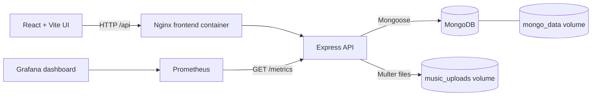

# Music Manager

Music Manager is a college DevOps mini-project: a private, Spotify-inspired music library built with React, Vite, Express, MongoDB, and Docker Compose. Each account has its own uploaded tracks and playlists. It includes automated tests, CI, Prometheus metrics, and a provisioned Grafana dashboard.

## Features

- Register and sign in with bcrypt password hashing and JWT authentication.
- Upload MP3, WAV, OGG, FLAC, AAC, and WebM audio with title, artist, and optional album metadata.
- Play, pause, seek, change volume, and browse tracks from a responsive dark interface.
- Search by title, artist, or album; sort by title, artist, album, or date added.
- Create, rename, edit descriptions, and delete playlists; add or remove tracks.
- Keep track and playlist access private to their owner, including audio streaming.
- Persist MongoDB data and uploaded audio across container restarts.
- Scrape API request and latency metrics into Prometheus and view a provisioned Grafana dashboard.

## Architecture



The browser stores the signed-in session token locally and sends it in the `Authorization: Bearer` header. Express authenticates requests before loading private library or playlist records. Track queries include the authenticated owner's ID. Playlist updates check that every referenced track belongs to that same account. Uploaded files use random server-generated names; the original name is retained only as display metadata.

### Main components

| Path | Purpose |
| --- | --- |
| `frontend/` | React UI, Vite configuration, production Nginx proxy |
| `backend/src/` | Express app, MongoDB models, authentication, library and playlist routes |
| `backend/tests/` | Jest and Supertest API tests |
| `frontend/src/*.test.jsx` | Jest and Testing Library interaction tests |
| `docker-compose.yml` | MongoDB, API, web UI, Prometheus, Grafana |
| `monitoring/` | Prometheus scrape config and provisioned Grafana datasource/dashboard |
| `.github/workflows/ci.yml` | Test and build jobs for GitHub Actions |

## Run with Docker Compose

Requirements: Docker Engine and the Docker Compose plugin.

1. Create a local environment file and set fresh values for `JWT_SECRET` and `GRAFANA_ADMIN_PASSWORD`. Do not commit `.env`.

   ```bash
   cp .env.example .env
   openssl rand -base64 48
   ```

   Put the generated value into `JWT_SECRET` in `.env`; choose a separate local Grafana password. The placeholder values in `.env.example` are examples only.

2. Build and start the application:

   ```bash
   docker compose up --build
   ```

3. Open the app at <http://localhost:5173>, create an account, then upload audio.

Useful endpoints:

| Service | Address | Login |
| --- | --- | --- |
| Music Manager | <http://localhost:5173> | Create an app account |
| API health | <http://localhost:4000/api/health> | None |
| Prometheus | <http://localhost:9090> | None |
| Grafana | <http://localhost:3000> | `GRAFANA_ADMIN_USER` and `GRAFANA_ADMIN_PASSWORD` from `.env` |

The Grafana dashboard is provisioned under the **Music Manager** folder. Allow at least one Prometheus scrape interval (15 seconds) after startup for data to appear. The dashboard reports values observed by the running application; it does not contain sample monitoring data.

To stop containers while keeping data, use `docker compose down`. MongoDB documents, music uploads, Prometheus history, and Grafana state use named volumes. Do not use `docker compose down -v` unless you intentionally want to remove all of those volumes.

## Local development

Requirements: Node.js 20 or newer, npm, and a reachable MongoDB instance. Docker can provide only MongoDB if desired:

```bash
cp .env.example .env
# Set JWT_SECRET to a fresh value in .env; set MONGODB_URI for your local MongoDB.
docker compose up -d mongo
```

Set both `JWT_SECRET` and `GRAFANA_ADMIN_PASSWORD` to non-placeholder local values before using Compose; Compose validates required values even when starting only the MongoDB service.

In one terminal, run the API from `backend/`:

```bash
cd backend
npm ci
npm run dev
```

In another terminal, run the frontend from the repository root:

```bash
npm ci
npm run dev
```

Vite serves the app on port 5173 and proxies `/api` to `http://localhost:4000`. Set `API_PROXY_TARGET` if the backend uses another address. The local upload directory defaults to `backend/uploads/`; Docker stores files in the persistent `music_uploads` volume.

## Configuration

Copy `.env.example` to an untracked `.env`. The API loads this root file when run locally. Compose reads it for variable substitution and passes only the required values to containers.

| Variable | Purpose | Default |
| --- | --- | --- |
| `NODE_ENV` | API log format and runtime mode | `development` |
| `PORT` | API listen port | `4000` |
| `CLIENT_ORIGIN` | Allowed browser origin for API CORS | `http://localhost:5173` |
| `MONGODB_URI` | MongoDB connection string | unset; DB routes respond with 503 |
| `JWT_SECRET` | Private key for signing/verifying tokens | unset; auth responds with 503 |
| `JWT_EXPIRES_IN` | JWT lifetime | `1d` |
| `UPLOAD_DIR` | Persistent audio directory | `backend/uploads/` |
| `MAX_UPLOAD_SIZE_MB` | Maximum size per upload | `25` |
| `GRAFANA_ADMIN_USER` | Grafana administrator name | `admin` |
| `GRAFANA_ADMIN_PASSWORD` | Grafana administrator password | required by Compose |

Never commit `.env`, production JWT keys, or real credentials. Rotate the JWT key if it is exposed; existing tokens signed with the previous key will stop working.

## API overview

All request and response bodies use JSON except the multipart upload route.

| Method | Path | Access | Purpose |
| --- | --- | --- | --- |
| `GET` | `/api/health` | Public | API and database readiness |
| `GET` | `/metrics` | Internal monitoring | Prometheus metrics |
| `POST` | `/api/auth/register` | Public | Create account and return JWT |
| `POST` | `/api/auth/login` | Public | Verify credentials and return JWT |
| `GET` | `/api/auth/me` | Bearer token | Current account profile |
| `GET` | `/api/tracks?q=&sort=&order=` | Bearer token | Search and sort the owner's tracks |
| `POST` | `/api/tracks` | Bearer token | Multipart upload (`audio`, `title`, `artist`, optional `album`) |
| `GET` | `/api/tracks/:id/stream` | Bearer token | Stream owner's audio with byte ranges |
| `DELETE` | `/api/tracks/:id` | Bearer token | Delete owner's track and file |
| `GET` | `/api/playlists` | Bearer token | List owner's playlists |
| `POST` | `/api/playlists` | Bearer token | Create playlist |
| `PATCH` | `/api/playlists/:id` | Bearer token | Rename, describe, or change owned track membership |
| `DELETE` | `/api/playlists/:id` | Bearer token | Delete owner's playlist |

## Testing and CI

Run the backend API tests (Jest + Supertest):

```bash
cd backend
npm ci
npm test
```

Run frontend interaction tests and a production build from the repository root:

```bash
npm ci
npm test
npm run build
```

The backend suite covers health, bcrypt/JWT registration, input validation, authentication, owner-scoped searches, private streaming, and playlist ownership. The frontend suite exercises sign-in submission and account creation mode. GitHub Actions runs backend tests, frontend tests/build, and builds both service images on pushes and pull requests to `main` or `master`.

## Monitoring and logging

- The API exposes Prometheus default Node.js process metrics plus request totals and latency histograms at `/metrics`.
- `monitoring/prometheus.yml` scrapes the API every 15 seconds.
- Grafana provisions the Prometheus datasource and an overview dashboard with request rate, p50/p95 latency, requests by route, process memory, and scrape status.
- Express uses Morgan request logs. Development logs are concise; production logs use the combined format. Errors return JSON without leaking server stack traces.
- `/api/health` responds 200 when MongoDB is connected and 503 while the API is degraded. Compose health checks gate API and frontend startup.

## Demonstration and viva

Follow [the project demonstration and viva guide](docs/DEMO_AND_VIVA.md) for a short presentation flow, architecture explanation, sample questions, and troubleshooting notes.
